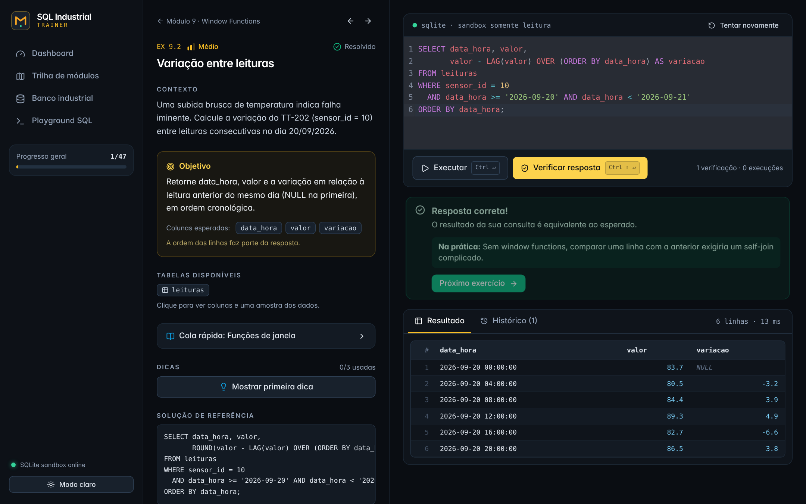

# SQL Industrial Trainer

**[Abrir a demonstração online](https://victor-alrib.github.io/sql-industrial-trainer/)**

**Plataforma web para aprender SQL resolvendo problemas de manutenção e automação industrial, com SQLite rodando no navegador e correção automática pelo resultado da consulta.**



---

## Problema

Cursos de SQL costumam usar exemplos genéricos (clientes, pedidos, funcionários) e muita teoria. Quem vem da engenharia aprende melhor com problemas que reconhece, como alarmes sem reconhecimento, equipamento superaquecendo, backlog de manutenção, MTTR e disponibilidade.

Corrigir exercícios de SQL também é difícil. Uma mesma pergunta admite várias consultas corretas (JOIN ou subconsulta, CTE ou window function, aliases diferentes). Por isso, comparar o texto digitado com um gabarito fixo reprova respostas certas.

O projeto resolve as duas coisas:

1. **47 exercícios práticos**, todos com contexto de chão de fábrica, em 10 módulos progressivos (de `SELECT` até window functions e um desafio final);
2. **um validador que compara o resultado das consultas**, não o texto, e explica em português por que a resposta está errada.

## Abordagem

### Dados
Um **banco SQLite fictício gerado por código**, com semente fixa (PRNG `mulberry32`). Ele é idêntico em toda execução, então a resposta do aluno e a resposta de referência sempre veem os mesmos dados.

| Tabela | Registros |
|---|---:|
| `linhas_producao` | 4 |
| `equipamentos` | 16 |
| `sensores` | 27 |
| `leituras` | 4 860 |
| `alarmes` | 174 |
| `ordens_manutencao` | 69 |
| `operadores` | 16 |
| `eventos_operacionais` | 188 |

Os números vêm de `scripts/data-summary.mts`; a saída está em `resultados/resumo-banco.md`.

O banco tem uma narrativa coerente. As leituras têm ciclo diário, ruído e picos ocasionais. Os alarmes são *derivados* das leituras que saem da faixa do sensor. O centro de usinagem CUS-202 degrada ao longo de setembro, com temperatura e vibração em alta e falhas reincidentes. **Por quê:** dados gerados de forma determinística e reproduzível dispensam arquivos externos e garantem que a correção seja justa.

### Técnicas
- **SQLite em WebAssembly (sql.js)** executado dentro de um **Web Worker**. Cada consulta roda numa **cópia descartável e somente leitura** do banco (`PRAGMA query_only = 1`). **Por quê:** é SQL real, sem servidor, e o código do aluno fica isolado do estado do aplicativo.
- **Timeout de 5 s:** se a consulta trava (por exemplo, uma CTE recursiva infinita), o worker é destruído e recriado.
- **Validação por resultado** (`src/engine/compare.ts`):
  - colunas casadas pelo conteúdo, com nome e ordem livres;
  - números comparados com tolerância de 0,01;
  - linhas comparadas como multiconjunto;
  - ordem exigida só quando o exercício pede `ORDER BY`, com empates aceitos (`orderKeys`).
- **Diagnóstico de erros:** as mensagens do SQLite são traduzidas para português, com sugestão do nome mais próximo (distância de Levenshtein). O validador classifica o erro em colunas, nº de linhas, valores, arredondamento ou ordem e dá dicas específicas (`= NULL`, divisão inteira, `NOT IN` com NULL, filtro no `WHERE` que anula o `LEFT JOIN`).
- **Pedagogia:** dicas progressivas (conceito → estrutura → esqueleto). A solução só fica disponível após 3 verificações erradas, e consultá-la marca o exercício para revisão no dashboard.

> Este projeto **não treina nem usa modelo de IA**. É um projeto de dados/SQL e de engenharia de software. O validador segue a mesma ideia da *execution accuracy* usada para avaliar sistemas text-to-SQL: julgar uma consulta pelo resultado que ela produz.

## Resultados

Tudo o que foi efetivamente medido ou verificado:

| Verificação | Resultado |
|---|---|
| Testes automatizados (Vitest) | **88 de 88 passando** (`resultados/testes-vitest.txt`) |
| Soluções de referência | todas as 47 executam, retornam linhas e se autovalidam |
| Consultas alternativas corretas aceitas | 23 casos testados, todos aceitos |
| Erros típicos rejeitados com o diagnóstico esperado | 12 casos testados, todos corretos |
| Teste ponta a ponta no navegador (Playwright) | erro → dica → acerto → recuperação após timeout → persistência após recarregar: OK (`resultados/e2e-navegador.log`) |
| Versão de arquivo único sob uma CSP restritiva | OK (`resultados/smoke-arquivo-unico-csp.log`) |
| Tamanho da versão de arquivo único | 1 863,70 kB (732,60 kB com gzip) |
| Tempo das 47 consultas de referência (sql.js no Node.js, 4 repetições) | mediana 0,6 ms · p95 4,1 ms · máx. 75 ms |
| Geração do banco + inicialização do SQLite | 119 ms |

As saídas das consultas de referência mais importantes (equipamentos > 80 °C, MTTR, disponibilidade e relatório de confiabilidade) estão em `resultados/saidas-solucoes.txt`.

## Como rodar

Requisitos: **Node.js 20+** e npm. O projeto foi desenvolvido com Node 22.

```bash
npm install            # instala as dependências do package.json
npm run dev            # abre em http://localhost:5173
npm test               # roda os 88 testes
npm run build          # gera o site estático em dist/
npm run build:single   # gera um único index.html autocontido em dist-single/
```

Scripts opcionais:
- `npx tsx scripts/data-summary.mts` e `npx tsx scripts/solutions.mts 6.3 10.4` geram resumos do banco e das soluções;
- `npm run test:e2e` e `npm run screenshots` precisam do Playwright (`npm i -D playwright && npx playwright install chromium`) e de `npx vite preview --port 4173` rodando.

**Chaves e segredos:** o projeto não usa nenhuma API externa, chave ou token. Não há variáveis de ambiente a configurar.

**Deploy:** `.github/workflows/deploy.yml` roda os testes, gera o build e publica no GitHub Pages a cada push na `main`. Como o app usa rotas com hash, funciona em qualquer hospedagem estática sem configuração extra.

## Adicionando exercícios

Inclua um objeto em `src/content/exercises.ts`:

```ts
{
  id: '5.6', moduleId: 5, difficulty: 'medio', title: '...',
  context: 'Situação na fábrica...', objective: 'O que retornar...',
  expectedColumns: ['tag', 'qtd'], tables: ['equipamentos'],
  hints: ['conceito', 'estrutura', 'esqueleto com ___'],
  solution: 'SELECT ...',
  options: { orderMatters: true, orderKeys: [1] }, // opcional
  takeaway: 'Lição para a prática.',
}
```

Rode `npm test`: o teste confirma automaticamente que a solução executa, retorna linhas e se autovalida.

## Limitações e próximos passos

- **As soluções de referência ficam no código que roda no navegador.** Isso não importa para estudo, mas inviabiliza uso avaliativo. Próximo passo: mover a validação para um backend que reutilize `src/engine/core.ts`.
- **Abrir o `index.html` de arquivo único direto do disco (`file://`)** bloqueia o Web Worker. A execução cai para o thread principal, onde não há timeout; por isso o modo recomendado é a versão hospedada ou `npm run dev`.
- O progresso fica só no `localStorage` do navegador. Há exportar/importar em JSON, mas não há contas nem sincronização.
- Os testes de navegador rodaram no Chromium. Próximas validações: testes com alunos, auditoria de acessibilidade e outros navegadores.
- O dashboard tem um único gráfico, simples (atividade dos últimos 14 dias).
- Ideias: mais exercícios por módulo, modo de prova com tempo, explicação gerada por LLM a partir do diagnóstico do validador.

## Stack

React 18 · TypeScript 5 · Tailwind CSS 3 · Vite 5 · sql.js (SQLite/WebAssembly) · CodeMirror 6 · Zustand · lucide-react · Vitest · Playwright

## Estrutura

```
├── src/db/seed.ts          esquema + gerador determinístico do banco
├── src/engine/             sandbox SQL, worker, validador, tradução de erros
├── src/content/            módulos e exercícios
├── src/store/, src/lib/    progresso persistido e indicadores do dashboard
├── src/pages/, components/ interface
├── tests/                  testes de conteúdo, validador e sandbox
├── scripts/                resumo do banco, testes de navegador e capturas
├── docs/                   imagens usadas na documentação
└── resultados/             logs de testes, saídas de consultas e capturas de tela
```

## Autoria

Desenvolvido por **Victor** (Engenharia de Controle e Automação — IFSP), com auxílio de IA (Claude) na escrita do código e da documentação.

## Licença

[MIT](LICENSE)
